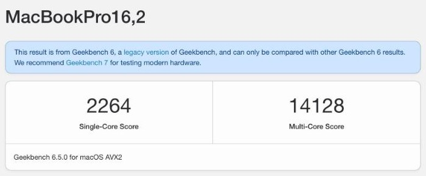
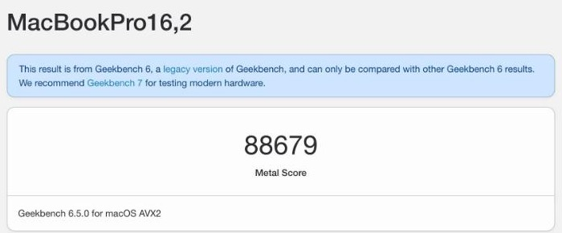
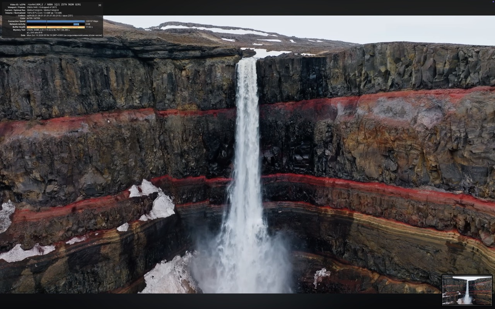
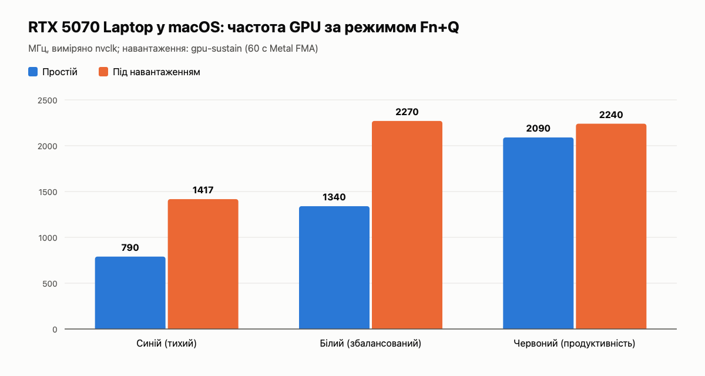

# macOS Sequoia на Lenovo Legion 5 15IRX10 (i7-14700HX + RTX 5070 Laptop)

Як я довів хакінтош на ігровому ноутбуці Lenovo Legion 5 15IRX10 (83LY) до стану «відкрив кришку і працюєш»: NVIDIA RTX 5070 з Metal, нативний Wi-Fi та Bluetooth MediaTek MT7925, тачпад, повна продуктивність CPU, плавний Chrome. Це журнал змін і покрокова інструкція.

> ⚠️ Хакінтош — це експеримент на власний ризик. Нічого тут не стосується BIOS/прошивок; Windows (dual-boot) не чіпалась. Робіть бекапи EFI перед кожною зміною.

---

## Характеристики ноутбука

| | |
|---|---|
| Модель | Lenovo Legion 5 15IRX10 (83LY) |
| Процесор | Intel Core i7-14700HX: 20 ядер (8 P + 12 E), 28 потоків, до 5,5 ГГц |
| Відеокарта | NVIDIA GeForce RTX 5070 Laptop (GB206), 8 ГБ GDDR7 |
| Оперативна пам'ять | 32 ГБ DDR5-5600 (2 × 16 ГБ, Micron) |
| Накопичувач | Kingston KC3000 2 ТБ NVMe (PCIe 4.0 x4) |
| Екран | 15", 2560×1600, 165 Гц |
| Wi-Fi / Bluetooth | MediaTek MT7925 (Wi-Fi 7 / BT 5.4) |
| LAN | Realtek RTL8111 |
| Батарея | 80 Вт·год (повна ємність 5154 мА·год, 20 циклів) |
| ОС | macOS Sequoia 15.8.1 (24H32) + Windows (dual-boot через OpenCore) |
| SMBIOS | MacBookPro16,2 |

## Що працює в macOS

| Компонент | Стан |
|---|---|
| CPU | ✅ усі 28 потоків, повний турбо одного ядра (див. «CPU») |
| NVIDIA RTX 5070 | ✅ Metal 3 через NullMoth 2.4.3, 165 Гц, HiDPI «як 1920×1200» |
| Wi-Fi MT7925 | ✅ нативний Wi-Fi (MtkWlan + MtkWlanNative), ~93/93 Мбіт/с |
| Bluetooth MT7925 | ✅ MtkBt 0.2.2 + BlueToolFixup |
| Тачпад | ✅ VoodooI2C (Raptor Lake 7A7D) |
| Клавіатура, яскравість | ✅ VoodooPS2 + BrightnessKeys |
| Звук | ✅ AppleALC |
| Fn+Q (режими Legion) | ✅ власний kext + екранна підказка, керує й відеокартою |
| LAN | ✅ RealtekRTL8111 |
| Сон / гібернація | ⏳ ще не налаштовано |

---

## Бали в тестах (Geekbench 6.5, режим «Продуктивність», від мережі)

### CPU

| Конфігурація | Single-core | Multi-core |
|---|---|---|
| Початково (XCPM, EPP 128) | 1799 | 12079 |
| HWP Maximum піднято до максимуму | 1724 | 11906 |
| CPUFriend, EPP 0x20 | 1936 | 13195 |
| MsrPeek keep EPP 0, кожні 100 мс | 2050 | 14003 |
| EPP 0 вручну (sysctl) | 2264 | 14128 |
| **Фінал: MsrPeek keep EPP 0, кожні 50 мс** | **2216** | **14438** |

Приріст: **+23% single-core, +20% multi-core**. Для порівняння, типові результати i7-14700HX у Windows: ~2700–2900 / 15000–17000. Решта різниці в single-core пов'язана з тим, що в macOS один потік тримається на ~3,7 ГГц. Стеля потужності пакета в macOS ~75 Вт, а в Windows Lenovo дає 163/100 Вт (PL2/PL1).

### GPU (RTX 5070 Laptop, NullMoth 2.4.3)

| Тест | Результат |
|---|---|
| **Metal (вікно Geekbench, 22.10)** | **97894 / 97510 / 95579** |
| Metal раніше | 88679 / 74117 / 72768 / 62886 |
| **OpenCL (22.10)** | **29517** |
| OpenCL раніше | 28076 / 21875 |

> Порівнюйте лише запуски з вікна Geekbench. Консольний `geekbench6 --gpu Metal` на цій системі дає ~71 тис. за будь-яких налаштувань.

Посилання: [Metal 97510](https://browser.geekbench.com/v6/compute/6946084) · [Metal 95579](https://browser.geekbench.com/v6/compute/6946093)

### Скриншоти результатів

| CPU (EPP 0) | GPU Metal | GPU OpenCL |
|---|---|---|
|  |  |  |

Старі скриншоти (до 22.10). Посилання: [CPU 2264/14128](https://browser.geekbench.com/v6/cpu/19372956) · [Metal 88679](https://browser.geekbench.com/v6/compute/6945805) · [OpenCL 28076](https://browser.geekbench.com/v6/compute/6945808)

**YouTube 4K@60 (VP9):** 3840×2160, пропущено лише 8 кадрів із 2872.



### Графіка робочого столу та мережа

| Тест | До | Після |
|---|---|---|
| CPU WindowServer, HiDPI 1920×1200 (сер. / пік) | 108% / 199% | 46% / 50% |
| Кадри/с у вікнах, стрес-тест | 25–35 | 63–88 |
| Wi-Fi speedtest | лише емуляція Ethernet | 93/93 Мбіт/с, пінг 11 мс |
| CPU у простої (пакет) | — | ~8 Вт, 62–66 °C |

---

## Що було зроблено (коротко)

### 1. Тачпад
VoodooI2C з урахуванням GPIO-контролера Raptor Lake (7A7D) і boot-arg `-vi2c-force-polling`. Тачпад працює з жестами.

### 2. Нативний Wi-Fi MediaTek MT7925
- `MtkWlan` 0.11.0 + `MtkWlanNative` 0.4.10 (проєкт mt7925-hackintosh-wifi, watchthelight), boot-args `mtkfe=native mtknativeif=1`.
- Перша спроба дала kernel panic (`thread_call group 'high' reached max thread cap`). Після диференційних тестів A/B стабільна версія: macOS бачить картку як «Wi-Fi», працює звичайне меню мереж, WPA2/WPA3.

### 3. Bluetooth MediaTek MT7925
- MtkBt 0.2.2 (watchthelight) завантажує прошивку в BT-частину MT7925.
- [BlueToolFixup](https://github.com/acidanthera/BrcmPatchRAM) 2.7.2 (Lilu) дозволяє macOS прийняти сторонній контролер.
- NVRAM: `bluetoothInternalControllerInfo` (14 нульових байтів) і `bluetoothExternalDongleFailed = 00`.
- Порядок у `Kernel/Add`: одразу після `Lilu.kext` — `BlueToolFixup.kext`, потім `MtkBt.kext`.
- Результат: Bluetooth вмикається, iPhone/навушники спаровуються, цикл перезапусків `bluetoothd` зник.

### 4. NVIDIA RTX 5070 (NullMoth 2.4.3)
Драйвер NullMoth (NVRM + NVMTL, Metal на NVIDIA). Поверх нього:
- **HiDPI «як 1920×1200» @165 Гц.** Масштаб голови дисплея в NVRM/NVKMS не працював (нульовий скейлер вікна). Зроблено патч масштабу viewport у NVRM і override дисплея, після чого macOS пропонує 1440×900 / 1600×1000 / 1680×1050 / 1920×1200 HiDPI.
- **Високий CPU WindowServer.** У `NVMTLDriver` staging-буфер знищувався після кожного завантаження, якщо він > 32 МіБ (поверхня 3840×2400 = 36,9 МБ). Однобайтовий патч порогу → WindowServer з ~108% до ~46%.
- **Page flip.** Прибрано `-nvrmnoflip`: flip працює, плавніше.
- **NVMTL surface-direct** (збірка NVMTLDriver з джерел NullMoth з прямим шляхом поверхонь): кадри/с у вікнах ×2–2,5.

### 5. CPU: повна швидкість одного ядра
Найцікавіше. Single-core був на ~30% нижчим, ніж у Windows.
- Причина: XCPM виставляє **HWP EPP = 128** («баланс») на всіх ядрах, тому P-ядра не розганяються до повного турбо під одним потоком. CPUFriend змінив EPP лише на 12 з 28 ядер.
- Рішення: власний діагностичний kext **MsrPeek** з keep-режимом. Кожні 50 мс він повертає `IA32_HWP_REQUEST` (Desired = 0, EPP = 0) на ядрах, де XCPM їх переписав.
  - boot-args: `msrpeekhwp=1 msrpeekepp=0 msrpeekms=50`
  - керування без перезавантаження: `sysctl debug.msrpeek_epp` / `debug.msrpeek_keep_ms`
- Результат: Geekbench **2216 / 14438** (було 1799 / 12079). У простої ~8 Вт, температура нормальна.
- Урок: `IOMappedRead64` приймає **фізичну** адресу. Одна з ранніх версій kext через це викликала паніку.

### 6. Fn+Q: режими живлення Legion (Тихий / Збалансований / Продуктивність)
На Legion клавіші **Fn+Q** перемикають режим живлення, і колір кнопки живлення змінюється: синій, білий або червоний. Перемикає вбудований контролер (EC) сам, але macOS про це нічого не знала.
- **FnQNotify.kext** (власний, [вихідний код](tools/fnq-kext)): ловить WMI-подію Lenovo `LENOVO_GAMEZONE_SMART_FAN_MODE_EVENT` (notify 0xE3), читає поточний режим (`GetSmartFanMode`) і публікує його в IORegistry. Він нічого не змінює, лише читає.
- **FnQOSD** (маленька програма в автозапуску, `~/Library/LaunchAgents`): показує на екрані підказку, як у Windows.
- Режим «Продуктивність» (червоний) дає найвищі ліміти CPU. Усі бали вище виміряні в ньому, від мережі.


### 7. Відеокарта і Fn+Q: три режими, як у Windows
Мета: щоб відеокарта не грілася постійно, а працювала на повну лише тоді, коли це потрібно, і щоб Fn+Q керував нею так само, як процесором.

**Як до цього дійшли**
1. Спершу ми передавали драйверу NVIDIA ліміт потужності (cTGP), як це робить Windows: 50 / 65 / 100 Вт. BIOS Lenovo через GPS `_DSM` дає лише цільову температуру (87 °C), тому cTGP підставляв патч NVRM. На Fn+Q ліміт тепер доходить до відеокарти навіть без перезавантаження ([patches/nvrm-gps](patches/nvrm-gps)). **Але продуктивність від цього не змінилась**: 60-секундний тест у синьому й червоному режимах дав однакові 9,4 TFLOPS.
2. Щоб зрозуміти чому, написав [nvclk](tools/nvclk), який читає частоти просто з драйвера. Виявилось, що NVMTL тримає карту на ~2 ГГц у P0 **завжди**, навіть у простої (`PERF_BOOST INFINITE` у кожному процесі з Metal). До ліміту ват карта не доходить, тож Fn+Q не мав на що впливати.
3. Рішення: вимкнути постійний буст NVMTL (`BOOST=0` у `nvrm610.conf`). Тоді карта сама керує частотою, а служба `nvclk watch` на кожне Fn+Q вмикає потрібний режим штатними командами NVIDIA RM:
   - 🔴 **Продуктивність**: `PERF_BOOST` до максимуму, карта завжди на ~2,1–2,3 ГГц;
   - ⚪ **Збалансований**: автоматика, у простої ~1,3 ГГц, під навантаженням скільки треба (до ~2,3 ГГц);
   - 🔵 **Тихий**: автоматика зі стелею `RATED_TDP / TURBO_BOOST`, у простої ~0,8 ГГц, під навантаженням не вище 1417 МГц.



| Режим | Простій | Навантаження | FP32 (60 с, gpu-sustain) |
|---|---|---|---|
| 🔵 Тихий | ~790 МГц | 1417 МГц | 5603 GFLOPS (~59%) |
| ⚪ Збалансований | ~1340 МГц | ~2270 МГц | 9564 GFLOPS |
| 🔴 Продуктивність | ~2090 МГц | ~2240 МГц | 9490 GFLOPS |

Перемикання займає ~1 с і працює одразу після входу в систему. Для порівняння, у Windows (`nvidia-smi`) під навантаженням: 1846 / 2123 / 2409 МГц.

**Що ще з'ясувалось**
- 9,4 TFLOPS на ~2,2 ГГц — це приблизно половина теоретичного FP32 для RTX 5070 Laptop. Решту втрачає перекладач NullMoth (Metal → NVK). Частота тут не обмежує.
- У відкритому драйвері NVIDIA немає команди, яка показує споживання карти у ватах, тому в macOS його не видно.
- Тести: [tools/gpu-sustain](tools/gpu-sustain/gpu-sustain.swift) (60 с безперервного навантаження Metal, GFLOPS щосекунди) і `nvclk 10` поруч із ним.

### 8. Google Chrome і мерехтіння
Із драйвером NullMoth Chrome за замовчуванням мерехтить (ANGLE Metal + Skia Graphite). Перевірені варіанти:

| Прапорці Chrome | Мерехтіння | Плавність |
|---|---|---|
| за замовчуванням | є | висока |
| `--use-angle=gl` | немає | гірша (усе малює процесор, відео теж) |
| `--disable-features=SkiaGraphite` | є (після перезавантаження) | висока |
| `+ --disable-gpu-rasterization` | рідко | висока ✅ *поточний вибір* |
| `+ --disable-gpu-compositing` | немає | помітно гірша: у YouTube багато пропущених кадрів |

**Порада:** для YouTube і щоденного перегляду **Safari** працює помітно краще за будь-який варіант Chrome, бо малює через Metal напряму, як сама macOS.

Не допомогли: `NVMTL_SCHEDULE_AFTER_SURFACE_WRITES=1` і вимкнення апаратного декодування відео. У Chrome 155 для Mac пункту `use-angle` у chrome://flags уже немає, тому прапорці задаються обгорткою (див. інструкцію).

---

## Інструкція

### A. Безпечний робочий процес з EFI
1. Тримайте **окрему флешку** з OpenCore для тестів. SSD EFI міняйте лише після кількох успішних завантажень з флешки.
2. **Одна зміна на одну копію EFI** (`Test-EFI-<назва>`), до кожної — список SHA-256.
3. Перед записом робіть бекап поточного EFI. Після запису звіряйте SHA, а `EFI/Microsoft` перевіряйте байт-у-байт (Windows не має постраждати).
4. Відкат: F12 → завантажитися з попередньої флешки / SSD.

### B. Bluetooth MT7925
1. Завантажте `MtkBt-0.2.2-RELEASE.zip` і `BrcmPatchRAM-2.7.2-RELEASE.zip`, звірте SHA-256 з GitHub.
2. Скопіюйте `MtkBt.kext` і `BlueToolFixup.kext` в `EFI/OC/Kexts`.
3. У `config.plist → Kernel → Add` додайте обидва записи **одразу після Lilu** (`MinKernel` 21.0.0).
4. Переконайтеся, що в NVRAM є `bluetoothInternalControllerInfo` і `bluetoothExternalDongleFailed`.
5. Перевірка після завантаження: `system_profiler SPBluetoothDataType` (Controller → Transport USB, чипсет THIRD_PARTY_DONGLE).

### C. Повний турбо одного ядра (EPP 0)
1. Додайте kext з HWP keep-режимом (у мене MsrPeek) у `Kernel/Add`.
2. boot-args: `msrpeekhwp=1 msrpeekepp=0 msrpeekms=50`.
3. Перевірка: Geekbench single-core має зрости приблизно на 20–25%.
4. Повернути поведінку XCPM без перезавантаження: `sudo sysctl debug.msrpeek_epp=-1`.

### D. Chrome без мерехтіння, але з GPU
1. Створіть AppleScript-програму `~/Applications/Chrome GL.app`:
   ```applescript
   property flags : "--disable-features=SkiaGraphite --disable-gpu-rasterization"
   on chromeRunning()
       return (do shell script "pgrep -x 'Google Chrome' >/dev/null && echo 1 || echo 0") is "1"
   end chromeRunning
   on launchWith(argList)
       if chromeRunning() then
           do shell script "open -a 'Google Chrome' " & argList
       else
           do shell script "open -a 'Google Chrome' " & argList & " --args " & flags
       end if
   end launchWith
   on run
       launchWith("")
   end run
   on open location u
       launchWith(quoted form of u)
   end open location
   ```
2. Скомпілюйте: `osacompile -o ~/Applications/"Chrome GL.app" ChromeGL.applescript`.
3. В `Info.plist` додайте `CFBundleURLTypes` (http, https) і `LSUIElement = true`, іконку візьміть з Chrome, підпишіть: `codesign --force --deep -s - ~/Applications/"Chrome GL.app"`.
4. Покладіть «Chrome GL» у Dock замість Chrome і зробіть його браузером за замовчуванням. Тоді посилання з інших програм теж відкриваються в Chrome з потрібним прапорцем.
5. У налаштуваннях Chrome увімкніть «Продовжити з того місця, де ви зупинилися».
6. Перевірка: chrome://gpu → *Skia Graphite: Disabled*, Rasterization *Software only*, Compositing *Hardware accelerated*. Якщо мерехтіння ще є, додайте `--disable-gpu-compositing`.

### E. Відеокарта: режими Fn+Q
Потрібен FnQNotify.kext (розділ 6). Далі за [tools/nvclk/README.md](tools/nvclk/README.md):
1. Зберіть `nvclk` (`build.sh`, потрібні заголовки open-gpu-kernel-modules 610.57.04) і скопіюйте в `/usr/local/bin`.
2. `sudo bash nvmtl-boost.sh off`, потім перезавантаження. Без цього кроку NVMTL тримає карту на максимумі в кожному режимі.
3. Додайте службу `local.nvclk.plist` у `~/Library/LaunchAgents`.
4. Перевірка: Fn+Q, далі `nvclk 3`. У синьому без навантаження має бути < 1000 МГц, у червоному ~2 ГГц.
5. Відкат: `launchctl bootout gui/$(id -u)/local.nvclk; nvclk tdp default; sudo bash nvmtl-boost.sh on`, потім перезавантаження.

### F. Що НЕ варто робити
- Не запускайте Chrome напряму з Launchpad/Spotlight, коли він закритий: стартує без прапорця.
- Не шукайте `use-angle` у Local State: Chrome 155 видаляє невідомий запис.
- Не вмикайте «відкривати ті самі вікна після входу»: macOS запустить Chrome без обгортки.

---

## Відомі проблеми (ще не вирішено)
- **Кути вікон і віджетів:** у віджетів «Календар» і «Погода» кути зрізані під 45° замість округлих, на кутах вікон іноді видно квадратні шматки шпалер. «Зменшити прозорість» не впливає. Схоже на помилку трансляції шейдерів у NVMTL; перемикачі `NVMTL_WS_WAIT_COMPLETION` і `NVMTL_NO_DIRTYONLY` не допомогли.
- **GPU працює приблизно на половину теоретичного FP32:** обмеження перекладача NullMoth (Metal → NVK), не частот.
- Ліміт потужності GPU (cTGP) доходить до драйвера, але в macOS на продуктивність не впливає (див. розділ 7).
- Один раз із трьох завантажень після входу був чорний екран.
- Сон/гібернація ще не налаштовані.
- У macOS стеля потужності CPU ~75 Вт (у Windows Lenovo/Intel DTT дає 163/100 Вт), тому під повним навантаженням на всі ядра трохи повільніше, ніж у Windows.

---

## Подяки
- **NullMoth**: драйвер NVIDIA (NVRM/NVMTL) для macOS.
- **watchthelight**: MtkWlan / MtkWlanNative (Wi-Fi) і MtkBt (Bluetooth) для MT7925.
- **acidanthera**: OpenCore, Lilu, WhateverGreen, AppleALC, VirtualSMC, BrcmPatchRAM/BlueToolFixup, CPUFriend, RestrictEvents.
- **VoodooI2C**, **VoodooPS2**, **YogaSMC**, **USBToolBox**.

Зроблено разом із Claude (Anthropic): діагностика, реверс-інжиніринг, патчі й kext-и писалися в парі, а кожну зміну перевіряв власник ноутбука перезавантаженням з тестової флешки.
